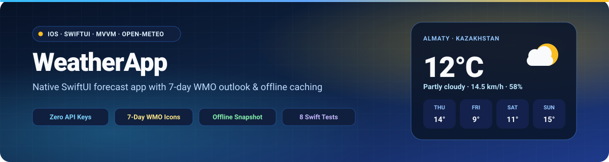
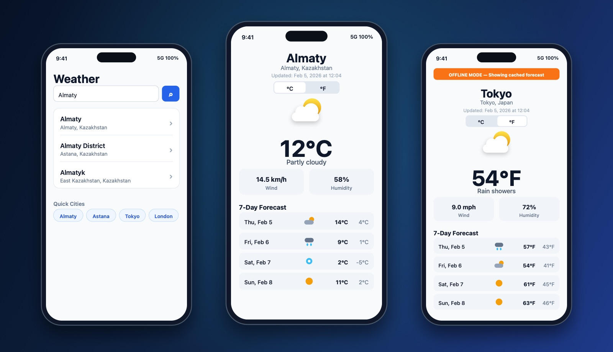
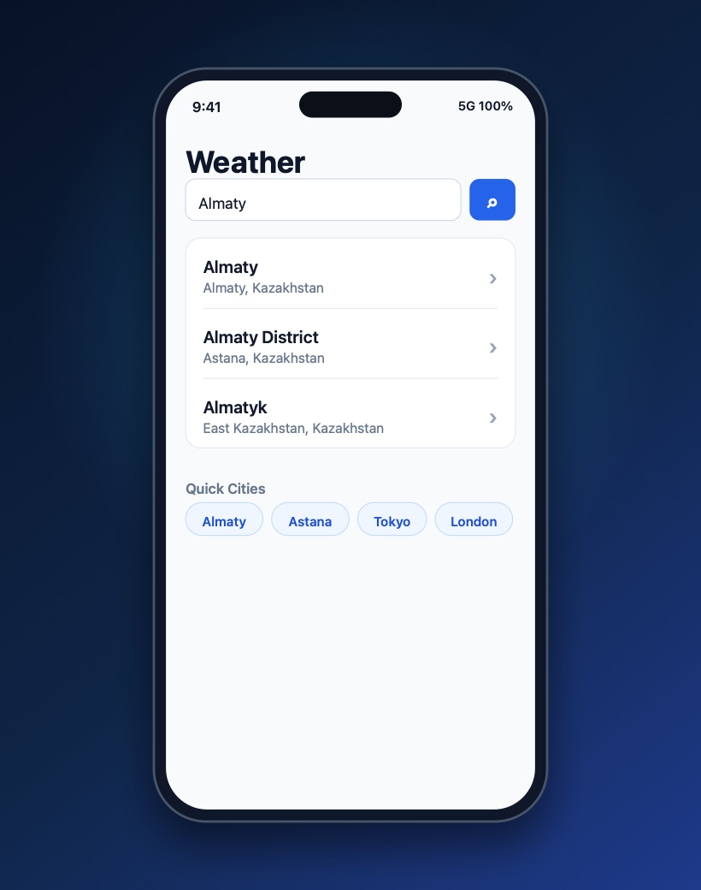
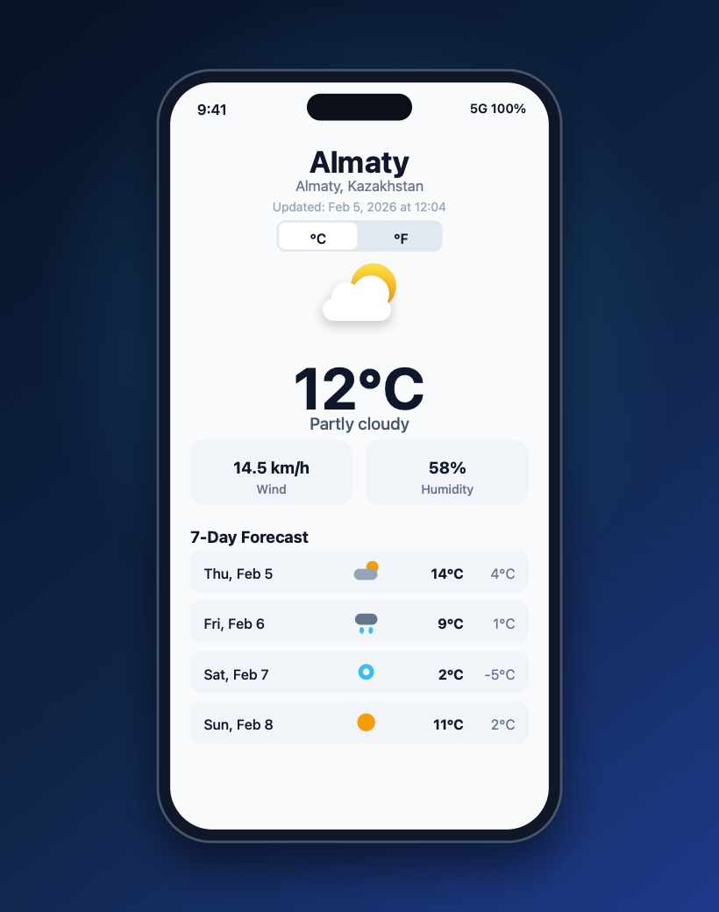
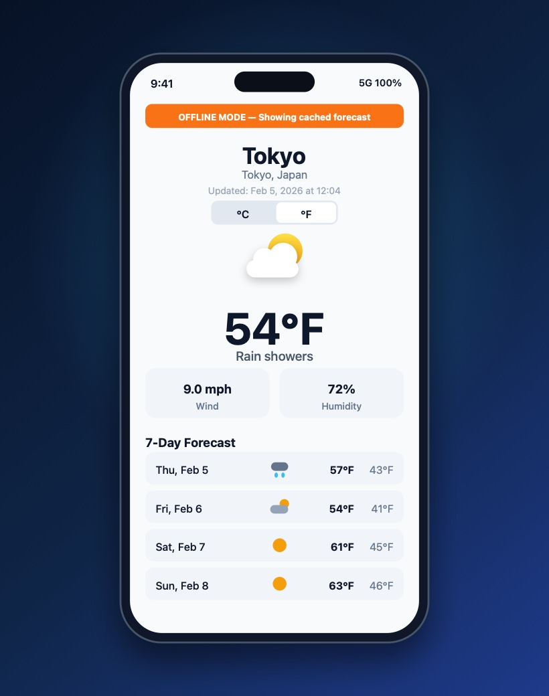
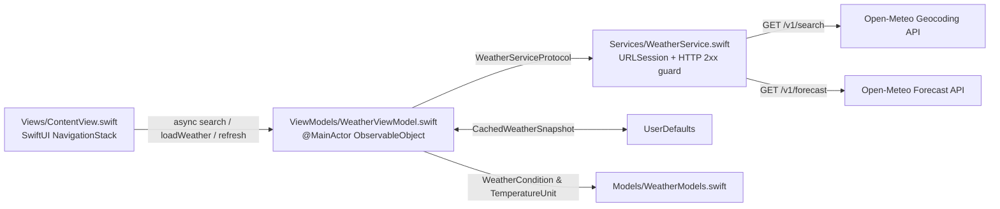

<div align="center">



<br /><br />


<br /><br />

[](https://www.swift.org/)
[](https://developer.apple.com/xcode/swiftui/)
[-22C55E?style=flat-square)](https://open-meteo.com/)
[](WeatherApp_ToleukhanTests/WeatherApp_ToleukhanTests.swift)
[](LICENSE)

**Native iOS SwiftUI weather application built with MVVM, `async/await`, Open-Meteo geocoding & 7-day WMO forecasts, `°C`/`°F` + `km/h`/`mph` unit switching, and automatic offline snapshot caching.**  
Requires **zero API keys** — clone, open in Xcode, and run immediately.

[Features](#key-features) · [Screenshots](#screenshots) · [Architecture](#architecture) · [Getting Started](#getting-started) · [Testing](#testing)

</div>

---

<p align="center">
  
</p>

## Key Features

- **Zero-Key Global Geocoding & Forecasts:** Powered by [Open-Meteo](https://open-meteo.com/) — search any city worldwide (plus one-tap quick cities) with `URLComponents` query encoding and validated HTTP `2xx` responses.
- **Full WMO Weather Code Mapping:** Renders accurate SF Symbols and human-readable condition labels (*Clear sky*, *Partly cloudy*, *Rain showers*, *Snow showers*, *Thunderstorm*, etc.) for both current conditions and every day of the **7-day forecast**.
- **Seamless Unit Conversion (`°C` ↔ `°F`):** Segmented unit picker converts current temperature, 7-day highs/lows, and wind speed (`km/h` ↔ `mph`) in real time.
- **Offline Snapshot Cache & Pull-to-Refresh:** Persists `CachedWeatherSnapshot` (selected `City` + `WeatherResponse` + timestamp) in `UserDefaults`, restores the last viewed city on launch, and automatically falls back with an **Offline Mode** banner when network requests fail.
- **Testable MVVM Architecture:** Protocol-injected `WeatherServiceProtocol` and `UserDefaults` enable fast, deterministic unit tests using Swift Testing (`@Test` / `#expect`).

---

## Screenshots

<table>
  <tr>
    <td width="33.3%">
      
      <p align="center"><strong>1. City Search</strong><br />Live Open-Meteo geocoding results and quick-pick cities.</p>
    </td>
    <td width="33.3%">
      
      <p align="center"><strong>2. Live Forecast (°C)</strong><br />City header, WMO condition, wind/humidity cards &amp; 7-day outlook.</p>
    </td>
    <td width="33.3%">
      
      <p align="center"><strong>3. Offline Cache &amp; °F</strong><br />Automatic cached snapshot fallback with imperial unit conversion.</p>
    </td>
  </tr>
</table>

---

## Architecture



---

## Getting Started

### Prerequisites
- **macOS** with **Xcode** (Swift 5.9+ / iOS Simulator)

### Build & Run
1. Clone the repository:
   ```bash
   git clone https://github.com/Alizhan-T/WeatherApp_AITU.git
   cd WeatherApp_AITU
   ```
2. Open `WeatherApp_Toleukhan.xcodeproj` in Xcode.
3. Select any iPhone Simulator and press **`⌘R`** to run.

---

## Testing

The `WeatherApp_ToleukhanTests` target contains **8 unit tests** written with Apple's **Swift Testing** framework (`import Testing`):

```bash
xcodebuild test \
  -project WeatherApp_Toleukhan.xcodeproj \
  -scheme WeatherApp_Toleukhan \
  -destination 'platform=iOS Simulator,name=iPhone 17 Pro' \
  -only-testing:WeatherApp_ToleukhanTests
```

Verified coverage:
- WMO code → SF Symbol & condition label mapping (including `80–82` rain showers and `85–86` snow showers)
- `°C`/`°F` temperature and `km/h`/`mph` wind unit conversions
- Safe `DailyWeather.forecastDays` slicing when upstream arrays differ in length + weekday formatting
- `URLComponents` query encoding and `daily=weather_code,...` parameter inclusion
- `WeatherViewModel` whitespace search validation, city snapshot caching, offline fallback on network failure, and launch restoration

---

## Project Structure

```text
WeatherApp_AITU/
├── Models/
│   └── WeatherModels.swift             # Codable DTOs, DailyForecastDay, TemperatureUnit, WeatherCondition
├── Services/
│   └── WeatherService.swift            # WeatherServiceProtocol, URLComponents builder, HTTP 2xx validation
├── ViewModels/
│   └── WeatherViewModel.swift          # @MainActor state, loading/error handling & offline snapshot cache
├── Views/
│   └── ContentView.swift               # NavigationStack UI, search, unit picker & 7-day forecast
├── WeatherApp_Toleukhan/
│   ├── WeatherApp_ToleukhanApp.swift   # @main SwiftUI app entry point
│   └── Assets.xcassets/                # AppIcon (1024×1024) & AccentColor
├── WeatherApp_ToleukhanTests/
│   └── WeatherApp_ToleukhanTests.swift # 8 Swift Testing specs (MockWeatherService + isolated UserDefaults)
├── assets/                             # Banner, AppIcon preview & framed iOS screens
├── LICENSE
└── README.md
```

---

## License & Author

Released under the [MIT License](LICENSE).  
Built by **[Alizhan Toleukhan](https://alizhan-t.github.io/)** ([`@Alizhan-T`](https://github.com/Alizhan-T)).
